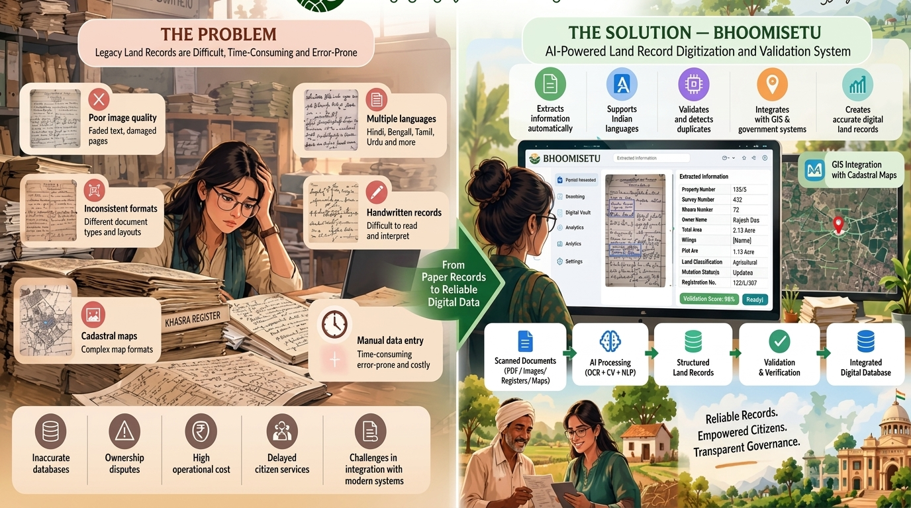
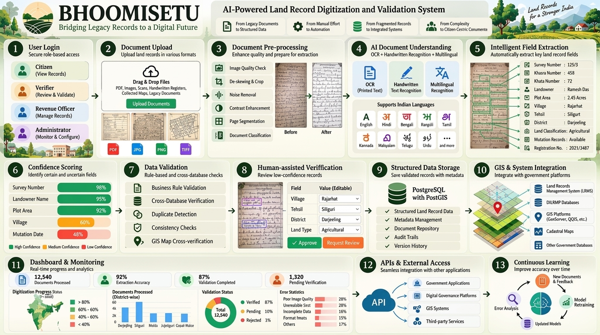

<div align="center">


# BhoomiSetu
### AI-Powered Land Record Digitization, Validation & GIS Intelligence Platform

**Smart India Hackathon 2026 · Problem Statement SIH26018**
*Bridging Legacy Records to a Digital Future*

[](LICENSE)
[](https://python.org)
[](https://reactjs.org)
[](https://fastapi.tiangolo.com)
[](https://www.postgresql.org)

</div>

---

## The Problem

India's land records system faces massive challenges — millions of physical documents sit in dusty government offices, often illegible, inconsistent, and inaccessible to the very citizens who need them most.



> *From Paper Records to Reliable Digital Data — BhoomiSetu makes it happen.*

### Key Challenges

| Challenge | Impact |
|-----------|--------|
| Poor image quality (faded, damaged) | Data loss and extraction errors |
| Multiple Indian languages | OCR and NLP complexity |
| Handwritten records | Difficult automated reading |
| Cadastral map formats | GIS integration barriers |
| Manual data entry | Time-consuming and error-prone |
| Inconsistent formats | Validation and cross-check failures |

**Resulting consequences:** Inaccurate databases · Ownership disputes · High operational cost · Delayed citizen services · Integration failures with modern systems

---

## The Solution — BhoomiSetu

BhoomiSetu is a full-stack, AI-powered platform that digitizes, validates, and geo-references India's land records — transforming legacy paper archives into structured, searchable, and auditable digital assets.

### How It Works — 13-Step Pipeline



| Step | Module | Description |
|------|--------|-------------|
| 1 | **User Login** | Secure role-based access (Citizen, Verifier, Revenue Officer, Admin) |
| 2 | **Document Upload** | Drag and drop PDFs, images, scans, handwritten registers |
| 3 | **Document Pre-processing** | Image quality check, de-skewing, noise removal, segmentation |
| 4 | **AI Document Understanding** | OCR + Handwritten recognition + Multilingual NLP |
| 5 | **Intelligent Field Extraction** | Auto-extracts Survey No., Khasra No., Landowner, Plot Area, etc. |
| 6 | **Confidence Scoring** | Flags high / medium / low confidence fields |
| 7 | **Data Validation** | Business rules, cross-database, duplicate detection, GIS cross-check |
| 8 | **Human-assisted Verification** | Officers review and correct low-confidence records |
| 9 | **Structured Data Storage** | PostgreSQL + PostGIS for geo-referenced land records |
| 10 | **GIS & System Integration** | LRMS, DILRMP, GeoServer, QGIS, Cadastral Maps |
| 11 | **Dashboard & Monitoring** | Real-time analytics, district-wise progress, validation status |
| 12 | **APIs & External Access** | REST APIs for government applications and third-party systems |
| 13 | **Continuous Learning** | Model retraining on new documents and officer feedback |

---

## Key Features

- **Multilingual OCR & Layout AI** — Bengali, Hindi, Marathi, Assamese, Tamil, Telugu, Urdu, Kannada, Malayalam, Punjabi and English
- **Digital Record Cross-Validation** — Automated discrepancy detection with officer resolution workflow
- **GIS & Cadastral Mapping** — Interactive boundary plot overlays with geo-coordinates
- **Role-Based Access Control** — Citizens, Verifiers, Revenue Officers, Administrators
- **Real-Time Analytics Dashboard** — District-wise processing stats, extraction accuracy, validation completion
- **API-First Architecture** — Seamless integration with government systems (LRMS, DILRMP, GIS platforms)
- **Audit Trail & Version History** — Complete change log for every land record
- **Citizen Portal** — Citizens can view, upload, and request corrections on their own land records

---

## Tech Stack

### Frontend
```
React 18 + TypeScript + Vite
TailwindCSS + Lucide Icons
React Query (TanStack)
React Router v6
Leaflet.js (GIS Maps)
```

### Backend
```
FastAPI (Python 3.11+)
PostgreSQL + PostGIS
SQLAlchemy + Alembic
Celery + Redis (async tasks)
JWT Authentication
```

### AI / ML Pipeline
```
Tesseract OCR + PaddleOCR
LayoutParser (document layout)
HuggingFace Transformers (multilingual NLP)
OpenCV (image pre-processing)
Custom confidence scoring models
```

### Infrastructure
```
Docker + Docker Compose
Nginx (reverse proxy)
GeoServer / QGIS integration
AWS S3 / MinIO (document storage)
```

---

## Project Structure

```
BhoomiSetu AI -- Final/
├── frontend/                  # React + TypeScript frontend
│   ├── src/
│   │   ├── components/        # Reusable UI components
│   │   │   ├── layout/        # AppLayout, Sidebar, CitizenSidebar
│   │   │   └── ui/            # Form elements, cards, modals
│   │   ├── pages/             # Route pages
│   │   ├── services/          # API service layer
│   │   ├── store/             # Zustand state management
│   │   └── utils/             # Helpers and constants
│   └── public/                # Static assets
├── backend/                   # FastAPI backend
│   ├── app/
│   │   ├── api/               # Route handlers
│   │   ├── models/            # SQLAlchemy models
│   │   ├── services/          # Business logic
│   │   ├── ai/                # OCR and ML pipeline
│   │   └── core/              # Config, auth, database
│   └── alembic/               # DB migrations
├── setup.bat                  # One-click setup script
├── start.bat                  # Start all services
└── stop.bat                   # Stop all services
```

---

## Quick Start

### Prerequisites
- Node.js 18+ and npm
- Python 3.11+
- PostgreSQL 15+ with PostGIS extension
- Redis (for async processing)

### 1. Clone the repository
```bash
git clone https://github.com/your-org/bhoomisetu.git
cd bhoomisetu
```

### 2. Run Setup (Windows)
```bat
setup.bat
```
This installs all dependencies, runs DB migrations, and sets up environment variables.

### 3. Configure Environment
Copy and edit `.env.example`:
```bash
cp .env.example .env
```

### 4. Start the Application
```bat
start.bat
```

| Service | URL |
|---------|-----|
| Frontend | http://localhost:5173 |
| Backend API | http://localhost:8000 |
| API Docs | http://localhost:8000/docs |

### 5. Stop All Services
```bat
stop.bat
```

---

## User Roles

| Role | Access |
|------|--------|
| **Citizen** | View own land records, upload documents, submit correction requests |
| **Verifier** | Review and validate AI-extracted fields, approve/reject records |
| **Revenue Officer** | Full record management, override decisions, manage citizens |
| **Administrator** | User management, system config, audit logs, analytics |

---

## Performance Metrics

- **12,540** Documents Processed
- **92%** Extraction Accuracy
- **87%** Validation Completion Rate
- **1,320** Pending Verification
- **98%** Confidence on Survey Number extraction

---

## Impact

> *"Reliable Records. Empowered Citizens. Transparent Governance."*

BhoomiSetu directly addresses the vision of **Digital India** and the **DILRMP (Digital India Land Records Modernization Programme)** by:

- Eliminating manual data entry bottlenecks
- Reducing land disputes through accurate, validated digital records
- Enabling citizens to access their land records anytime, anywhere
- Integrating seamlessly with existing government infrastructure
- Supporting all major Indian languages

---

## License

This project is built for the **Smart India Hackathon 2026** (Problem Statement SIH26018) under the Government of West Bengal and Government of India.

---

<div align="center">

Made with love for a Stronger India

**BhoomiSetu** · *Bridging Legacy Records to a Digital Future*

</div>
